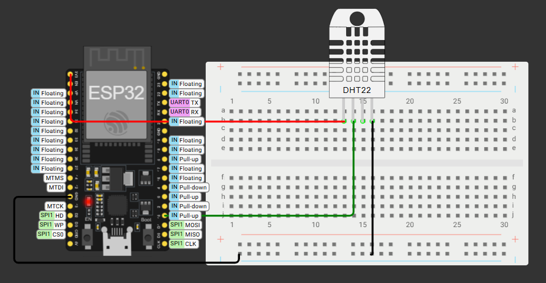
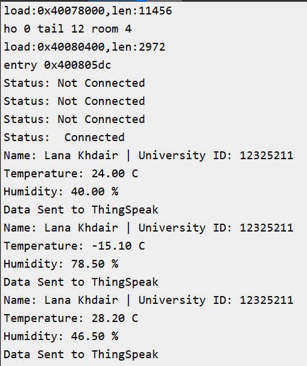
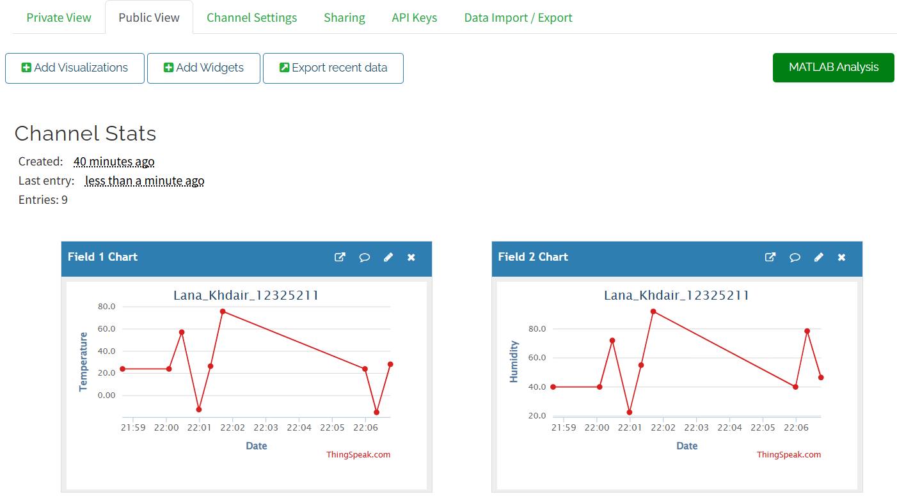
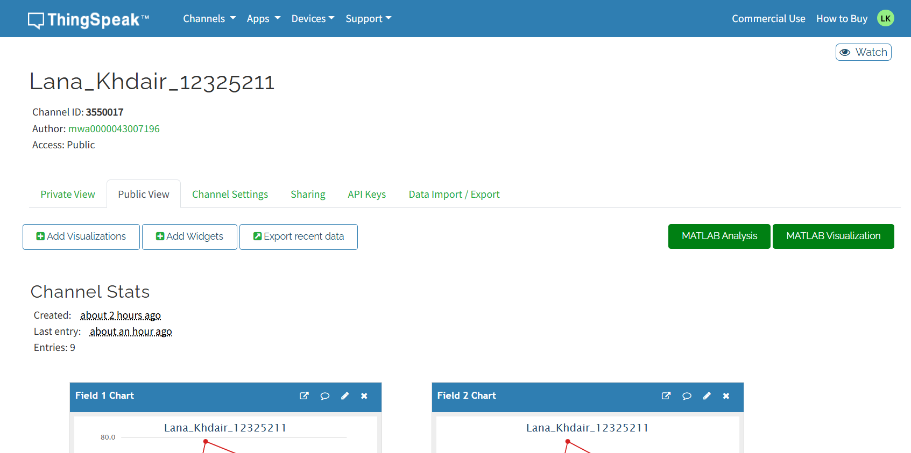

# ESP32 → ThingSpeak Temperature & Humidity Monitor

**Name:** Lana Mohanad Ahmad Khdair
**University ID:** 12325211

## Project Description
An ESP32 reads temperature and humidity from a DHT22 sensor and sends the
data to ThingSpeak over Wi-Fi every 20 seconds. The data is shown in two
public live charts (Field 1: Temperature °C, Field 2: Humidity %). The
university ID is printed in the serial log and sent as a status message
with every update.

## Links
- ThingSpeak public channel: https://thingspeak.com/channels/3550017
- Wokwi project: https://wokwi.com/projects/478884511088422913

## Wiring
| DHT22 | ESP32 |
|-------|-------|
| VCC   | 3V3   |
| SDA (DATA) | GPIO 15 |
| GND   | GND   |

Schematic: see `diagram.json` and the screenshot.

## How it works
1. Connect to Wi-Fi (`Wokwi-GUEST`)
2. Read temperature and humidity from the DHT22
3. Send both values to ThingSpeak with `ThingSpeak.writeFields()`
4. Wait 20 seconds and repeat

## Screenshots

### Wokwi circuit (wiring diagram)

### Serial Monitor

### ThingSpeak public view (temperature and humidity graphs)

### Channel page (Access: Public)

